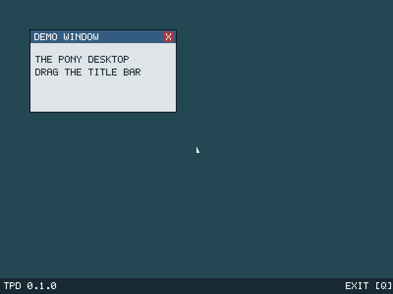
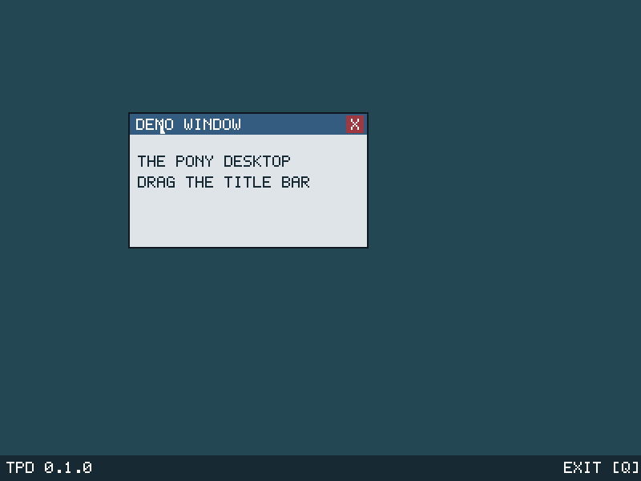

# v0.1.0 实际验证记录

记录日期：2026-11-17（Asia/Taipei）。HoofTTY 基线：`8d2951186df48773d6014290f08be9ebf0df8257`。

本次在当前云机器中真实构建并启动客户机，不以教程/上游历史报告替代测试。
QEMU 10.0.13，PC/TCG、默认 CPU、单 CPU、128 MiB、标准 VGA、SeaBIOS、800×600 RGB32、无网络。
测试脚本通过 QMP 注入客户机键盘及相对鼠标事件，并读取真实 VGA 截图。

## 已通过

| 检查 | 实际结果 |
|---|---|
| 内核/应用构建 | `make iso check`；ELF 静态 x86-64，无未解析符号、无 RWX 段；TPD 平坦映像 2002 字节，小于4096 |
| 宿主绘图边界 | 新 `tests/pixels.c`：极端矩形裁剪、边缘字形、pitch padding/首尾 canary、RGB mask 重排、无效字形、终端暂停恢复 |
| 原有可独立运行的宿主测试 | runtime（12464 memmove cases）、framebuffer、memory-span 均通过 |
| 原启动与 Shell | 启动到 `hoof>`，`echo baseline`、`run hello`、`meminfo` 正常 |
| 桌面画面 | VGA 像素验证背景色、窗口标题色；实际截图见下方 |
| 鼠标交互 | 标题栏拖动后核对旧/新窗口位置像素；点击关闭按钮后核对窗口区域恢复背景 |
| 退出/重入 | 3 次启动；前2次 Q 退出，第3次任务栏 EXIT 退出；退出后 Shell 正常回应 |
| 用户态证据 | GDB 读取 `user_state.active=1`、`last_cs=0x2b`、`last_number=5`、用户栈 RSP；`graphics_owned=true` |
| 资源回收 | hello 后与3次桌面退出后均为 allocated=16、tables=5、mapped=16，free=31501 |
| 原用户故障隔离 | `run privileged` 产生 User fault；之后 `echo healthy` 正常；串口未见 PANIC |
| 分发重放 | 将补丁应用到基线干净克隆，重复执行脚本2次，再构建内核并通过 ELF 检查 |
| 仓库检查 | TPD 和 HoofTTY `git diff --check` 无空白错误 |

最终通过的是仓库根 `make test`（本项目的目标，不是上游的同名大型测试目标）。
构建与测试底层退出状态已检查；串口、GDB、结果与完整命令输出保存在 [evidence](evidence/)。





## 失败/未验证

- 上游 `make test-host` **失败**：Makefile 引用不存在的 `shell/commands/help.c`，实际已改名为 friendship。
  没有改动该无关构建入口；其 shell 单测未执行，以上运行中的 Shell 验证不等同完整 parser/registry 单测。
- 没有执行上游完整 `make test` 多配置故障/调度矩阵；其部分测试仍期待旧 `ks>`、help/clear 命令。
- 图形会话期间强制用户故障的显示恢复路径只做代码审阅，未注入验证；原 privileged 测试在桌面退出后运行。
- 未做 RAM/分辨率矩阵、长时间压力测试、物理硬件/VMware/UEFI/USB 鼠标测试。
- 未模拟鼠标初始化失败、拔除、OOM、输入队列溢出和极快速点击；不能宣称所有错误恢复路径已验证。
- 截图和零 PANIC 只证明本次测试路径，没有内存错误检测器或全系统无缺陷保证。
- 未推送仓库或发布版本；未验证新云任务快照恢复。

## 机器工具说明

系统缺少 QEMU/xorriso/GDB，且当前用户无法安装到系统目录。
本次通过 Debian 签名包索引、APT 校验下载软件包，再解包到 `/workspace/tpd-tools`；未关闭 TLS/签名/哈希校验。
运行时使用以下覆盖（常规安装无需这些路径）：

```sh
export LD_LIBRARY_PATH=/workspace/tpd-tools/usr/lib/x86_64-linux-gnu
export QEMU=/workspace/tpd-tools/usr/bin/qemu-system-x86_64
export QEMU_DATA=/workspace/tpd-tools/usr/share/qemu
export QEMU_BIOS=/workspace/tpd-tools/usr/share/seabios/bios-256k.bin
export GDB=/workspace/tpd-tools/usr/bin/gdb
make test XORRISO=/workspace/tpd-tools/usr/bin/xorriso
```

`QEMU_DATA` 目录中另复制了同一签名 seabios 包的 BIOS/VGA ROM 文件，解决原包依赖绝对安装路径的问题。
Limine 下载与哈希验证使用 HoofTTY 原有 `fetch-limine.sh`，没有更改上游预期哈希。
